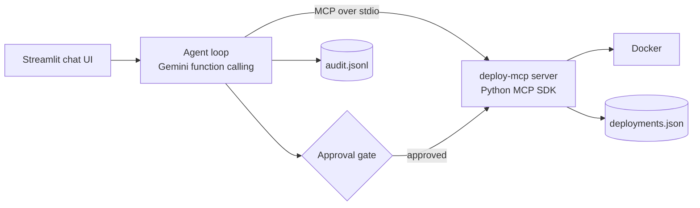

# Deployer: AI DevOps Agent (Gemini + MCP + Docker)


Chat-la sonna pothum, an LLM agent decides which tools to call and deploys your app. There is no fixed script: the model picks the tools, their order, and reacts to failures.


> Example: "build broken-app and run it as agent-demo". The agent builds, hits a failure, reads the logs and files, proposes a fix, asks for your approval, rebuilds and verifies the health check.


## Architecture





## MCP tools (deploy_server.py)


| Tool | What it does |

|---|---|

| `build_image` | Build a Docker image from an allowed folder |

| `run_container` | Run a container (host port to 8000) |

| `get_logs` | Last 50 log lines |

| `health_check` | HTTP check with retries |

| `read_file` / `write_file` | Inspect and fix files in allowed folders |

| `stop_container` | Stop and remove a container |

| `deployment_history` / `rollback` | Roll back to the previous different image |


## Safety design


- **Human approval gate in code**: `write_file`, `stop_container` and `rollback` need an explicit Approve in the UI. When I rejected a `requirements.txt` edit, the agent tried to edit the `Dockerfile` instead; the gate blocked that too. A prompt rule alone would not have stopped it.

- **Name guard**: containers must start with `agent-`, so the agent cannot touch your other containers.

- **Path allow-list**: file tools only work inside `sample-app` and `broken-app`.

- **Audit log**: every request, tool call, denial and summary goes to `audit.jsonl`.

- **Step limit**: the loop stops after 20 steps (enforced in code). The "max 2 fix attempts" rule is a prompt instruction, not a code limit.


## Run it


Requirements: Python 3.11+, Docker Desktop, a Gemini API key.


```bash

python -m venv venv

venv\Scripts\activate

pip install "mcp[cli]<2" google-genai python-dotenv streamlit

```


Create `.env`:


```

GEMINI_API_KEY=your-key

GEMINI_MODEL=gemini-3.8-flash

```


Create the demo apps and start the UI:


```bash

python setup_sample.py

python setup_broken.py

streamlit run app.py

```


Try these prompts:


1\. `sample-app ah tag sample-app:v1 la build panni agent-demo la run pannu, health check pannu`

2\. `broken-app ah tag broken-app:v1 la build panni agent-demo la run pannu, health check pannu` (approve the fix)

3\. `agent-demo ah rollback pannu, apparam health check pannu`


## Known limitations


- Local Docker only; no cloud deploy yet.

- Free-tier Gemini returns 503 often, so the agent falls back through several models.

- The agent's explanation can still be wrong; the health check result is the source of truth.


## Project files


`deploy_server.py` (MCP server), `agent_core.py` (agent loop), `app.py` (UI), `agent.py` (CLI version).


## License


MIT

